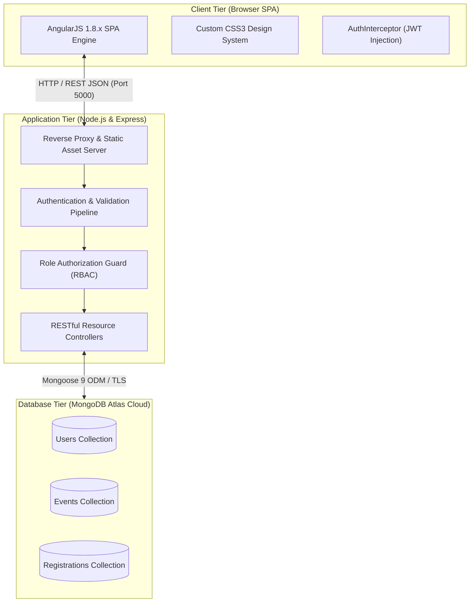
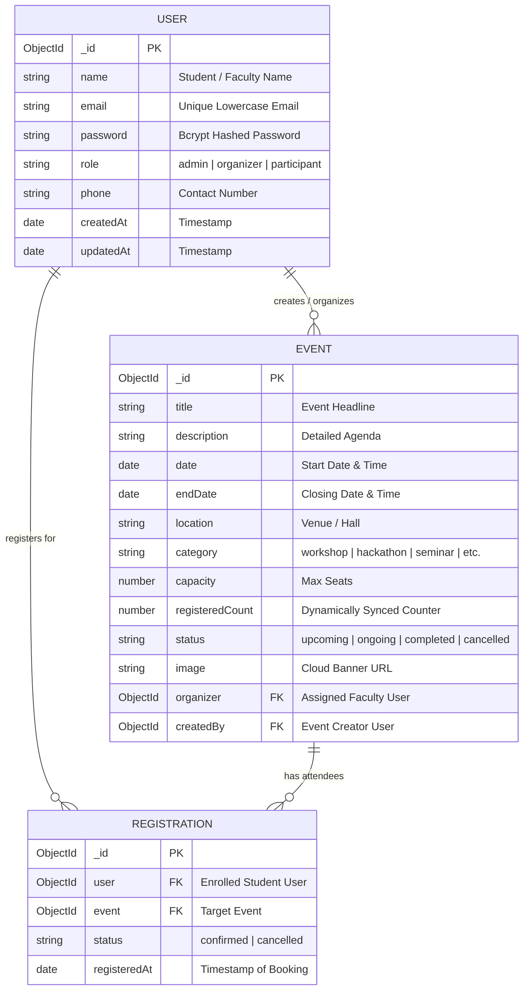
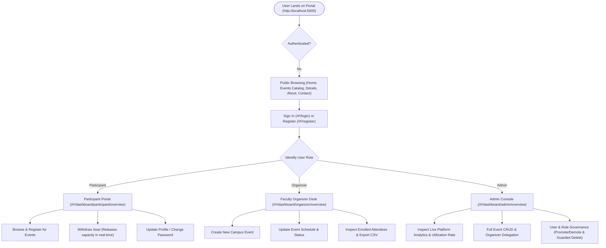

-# Event Management System (EMS) — College Project Report Notes

**Course:** Bachelor of Computer Applications (BCA) — Cybersecurity  
**Project Title:** Campus Event Management System with Role-Based Access Control  
**Academic Year:** 2025–2026  

---

## 1. Project Abstract & Objectives

The **Campus Event Management System (EMS)** is an enterprise-grade, full-stack web application architected to streamline the discovery, registration, organization, and administrative governance of collegiate events, technical symposiums, hackathons, and cultural festivals. 

From a cybersecurity perspective, the primary objective is to demonstrate strict adherence to the **Principle of Least Privilege (PoLP)** and defensive software engineering. Unlike conventional academic prototypes where access control is simulated via frontend DOM manipulation, this system implements cryptographically signed JSON Web Tokens (JWT), 10-salt-round bcrypt password hashing, server-level role authorization middleware, Mongoose schema-level uniqueness constraints to thwart race conditions and duplicate bookings, and centralized error sanitization.

---

## 2. System Design & Diagrams

### 2.1 Three-Tier Architecture



---

### 2.2 Database Entity-Relationship (ER) Diagram



> **Database Level Integrity:** The `REGISTRATION` collection enforces a compound unique index on `{ user: 1, event: 1 }`, guaranteeing at the database engine level that no participant can ever generate duplicate bookings for the same event.

---

### 2.3 User Workflow Architecture



---

## 3. Checklist of 12 Webpage Screens for College Report

Your report requires **12 distinct webpage screenshots**. Use this numbered checklist to capture every screen with its exact route:

| # | Screen Name | URL / Route | Recommended User Session | Key Visual Elements to Capture in Screenshot |
|---|-------------|-------------|--------------------------|----------------------------------------------|
| **1** | **Landing / Home Portal** | `http://localhost:5000/#!/` | Guest | Hero section with gradient text, 4 platform metric counters, and Featured Summits grid |
| **2** | **Event Discovery Catalog** | `http://localhost:5000/#!/events` | Guest / Any | Search bar, Category filter dropdown, Status dropdown, and responsive Event Cards grid |
| **3** | **Event Details & Booking** | `http://localhost:5000/#!/events/<id>` | Guest or Participant | Event banner image, full description, venue schedule, faculty organizer card, and seat capacity meter bar |
| **4** | **Student Registration** | `http://localhost:5000/#!/register` | Guest | Input form with Name, College Email, Phone, Password, and Confirm Password fields |
| **5** | **Secure Portal Login** | `http://localhost:5000/#!/login` | Guest | Credential input fields, Sign In CTA, and the **Quick-Fill Demo Credentials box** |
| **6** | **About & Cybersecurity Architecture** | `http://localhost:5000/#!/about` | Guest / Any | System objectives, 4 cybersecurity pillars (Bcrypt, JWT, RBAC, Uniqueness), and Tech Stack cards |
| **7** | **Campus Technical Support** | `http://localhost:5000/#!/contact` | Guest / Any | Department of Computer Applications contact info, academic support hours, and inquiry form |
| **8** | **Participant Dashboard** | `http://localhost:5000/#!/dashboard/participant/overview` | Participant (`participant@ems.edu`) | 3 Metric cards (Total Bookings, Upcoming Active, Cancelled), Enrolled Events table, and Cancel buttons |
| **9** | **Profile & Security Center** | `http://localhost:5000/#!/dashboard/profile` | Any Logged-in User | User identity badge with initials, Profile Information tab, and **Change Password & Security tab** |
| **10** | **Faculty Organizer Desk** | `http://localhost:5000/#!/dashboard/organizer/overview` | Organizer (`organizer@ems.edu`) | Portfolio Analytics (Assigned Events, Total Enrolled, Seat Fill Rate %), Assigned Events table, and **Create New Event** button |
| **11** | **Organizer Attendee Roster & CSV Export** | Modal in `#!/dashboard/organizer/overview` | Organizer (`organizer@ems.edu`) | Click **Attendees** on Cybersecurity Summit: Shows enrolled student roster, in-modal search, and **Download Attendees CSV** button |
| **12** | **Admin Governance Console** | `http://localhost:5000/#!/dashboard/admin/overview` | Admin (`admin@ems.edu`) | Platform Analytics cards (User role breakdown, Event status breakdown, Seat Utilization %), and the **User & Role Control tab** showing role promotion dropdowns and self-protection locks |

---

## 4. Key Code Implementation Walkthroughs

### 4.1 JWT Authentication Middleware (`server/middleware/auth.js`)
```javascript
const jwt = require('jsonwebtoken');
const User = require('../models/User');
const config = require('../config');
const ApiError = require('../utils/ApiError');

const auth = async (req, res, next) => {
  try {
    const authHeader = req.headers.authorization;
    if (!authHeader || !authHeader.startsWith('Bearer ')) {
      throw ApiError.unauthorized('Access denied. No token provided.');
    }

    const token = authHeader.split(' ')[1];
    const decoded = jwt.verify(token, config.jwtSecret);
    const user = await User.findById(decoded.id);

    if (!user) {
      throw ApiError.unauthorized('User associated with this token no longer exists.');
    }

    // Attach authenticated user identity to request object
    req.user = user;
    next();
  } catch (error) {
    next(error);
  }
};
```
**Explanation for Report:**  
The `auth` middleware intercepts incoming HTTP requests, extracts the bearer token from the HTTP `Authorization` header, and verifies its cryptographic signature using `jwt.verify()`. Upon successful verification, the user record is fetched from MongoDB (excluding the password hash) and attached directly to `req.user`, allowing downstream route handlers to identify the requesting subject securely.

---

### 4.2 Role-Based Access Control Guard (`server/middleware/authorize.js`)
```javascript
const ApiError = require('../utils/ApiError');

const authorize = (...allowedRoles) => {
  return (req, res, next) => {
    if (!req.user) {
      return next(ApiError.unauthorized('Authentication required'));
    }

    if (!allowedRoles.includes(req.user.role)) {
      return next(
        ApiError.forbidden(
          `Access denied. Role '${req.user.role}' is not authorized for this action.`
        )
      );
    }

    next();
  };
};
```
**Explanation for Report:**  
The `authorize` higher-order function enforces the Principle of Least Privilege by asserting that `req.user.role` matches at least one of the whitelisted roles (e.g. `authorize('admin', 'organizer')`). If an unprivileged user (such as a Participant) attempts to make a `POST` or `DELETE` request to an administrative endpoint, the middleware immediately aborts execution and responds with HTTP 403 Forbidden.

---

### 4.3 Atomic Seat Capacity Synchronization (`server/models/Registration.js`)
```javascript
registrationSchema.statics.updateEventCount = async function (eventId) {
  const count = await this.countDocuments({
    event: eventId,
    status: 'confirmed'
  });

  await mongoose.model('Event').findByIdAndUpdate(eventId, {
    registeredCount: count
  });
};

// Post-save hook: auto-recalculate seat count after save or status modification
registrationSchema.post('save', async function () {
  await this.constructor.updateEventCount(this.event);
});
```
**Explanation for Report:**  
To prevent race conditions and inconsistencies where manual increments could drift from actual confirmed registrations, the system employs Mongoose lifecycle hooks. Whenever a registration document is saved, updated (e.g. status transitioned to `cancelled`), or deleted, `updateEventCount` executes an aggregate count of active confirmed bookings and atomically updates `registeredCount` on the parent `Event` document.

---

### 4.4 AngularJS HTTP AuthInterceptor (`client/app/app.js`)
```javascript
emsApp.factory('AuthInterceptor', ['$q', '$window', '$injector', function ($q, $window, $injector) {
  return {
    request: function (config) {
      var token = $window.localStorage.getItem('ems_auth_token');
      if (token && config.url.indexOf('/api/') === 0) {
        config.headers = config.headers || {};
        config.headers.Authorization = 'Bearer ' + token;
      }
      return config;
    },

    responseError: function (rejection) {
      if (rejection.status === 401 && rejection.config.url.indexOf('/api/auth/login') === -1) {
        $window.localStorage.removeItem('ems_auth_token');
        $window.localStorage.removeItem('ems_auth_user');
        var $location = $injector.get('$location');
        var AlertService = $injector.get('AlertService');
        AlertService.warning('Your session has expired. Please sign in again.');
        $location.path('/login');
      }
      return $q.reject(rejection);
    }
  };
}]);
```
**Explanation for Report:**  
The `AuthInterceptor` is an AngularJS HTTP service pipeline hook that automatically intercepts every outgoing `$http` request destined for `/api/*` and attaches the user's stored JWT in the `Authorization: Bearer <token>` header. Furthermore, if the server ever responds with HTTP 401 Unauthorized (e.g. expired token), the interceptor flushes `localStorage` and gracefully redirects the student to the login view with an informative alert.

---

### 4.5 Single-Port Unified Express SPA Host (`server/server.js`)
```javascript
// Serve static frontend assets from client/ directory
const clientPath = path.join(__dirname, '..', 'client');
app.use(express.static(clientPath));

// Fallback: serve index.html for all non-API GET routes (AngularJS SPA routing)
app.get(/^\/(?!api(\/|$)).*/, (req, res) => {
  res.sendFile(path.join(clientPath, 'index.html'));
});
```
**Explanation for Report:**  
To avoid CORS cross-origin complexities and enable single-service cloud hosting on platforms like Render.com, Express statically serves the `client/` directory. Any request not matching an `/api/*` endpoint falls through to `client/index.html`, granting AngularJS's `$routeProvider` full client-side routing authority.

---

## 5. Technical Challenges Faced & Engineering Solutions

| # | Challenge | Root Cause | Engineering Solution Implemented |
|---|-----------|------------|----------------------------------|
| **1** | **Local ISP DNS SRV Lookup Failure for MongoDB Atlas** | Node.js native DNS resolver failed with `querySrv ECONNREFUSED` on local ISP connections when attempting to resolve `mongodb+srv://`. | Discovered the underlying Amazon Web Services shard hostnames via Google Public DNS (`8.8.8.8`) and configured a direct multi-node replica set connection string with `tls=true&authSource=admin` in `.env`. |
| **2** | **Seat Capacity Desynchronization & Overbooking** | Independent manual counters could drift when students cancel registrations or multiple requests arrive simultaneously. | Implemented Mongoose schema-level lifecycle hooks (`post('save')`, `post('findOneAndUpdate')`, `post('findOneAndDelete')`) that query the true document count and atomically synchronize `Event.registeredCount`. |
| **3** | **Administrative Accidental Self-Lockout** | An administrator could accidentally demote their own account to Participant or delete their own user record from the User Governance panel. | Architected server-level validation checks in `userController.updateUserRole` and `userController.deleteUser` that compare `req.params.id === req.user._id.toString()`, rejecting self-demotion or self-deletion with HTTP 400 Bad Request. |
| **4** | **Ephemeral Cloud Filesystem & Broken Images** | Local image uploads on server storage get wiped whenever containerized cloud services (like Render) restart or sleep. | Adopted URL-based image referencing with Unsplash CDN banners coupled with a reliable default image fallback on the Event schema level (`DEFAULT_EVENT_IMAGE`). |
| **5** | **Single-Port Production Deployment** | Traditional setups require two separate servers (one for frontend and one for API), requiring complex CORS whitelisting. | Consolidated frontend and backend into a single Express server process that serves static AngularJS assets and routes API requests on port 5000. |

---

## 6. Cybersecurity Evaluation & Defense Matrix

| Security Domain | Threat / Vulnerability | Mitigation Implemented in EMS |
|-----------------|------------------------|-------------------------------|
| **Authentication** | Brute force, credential theft, plain text database leaks | Passwords salted and hashed with bcrypt (10 rounds); passwords masked with `select: false` on Mongoose queries; stateless signed JWT tokens. |
| **Authorization** | Privilege escalation, IDOR (Insecure Direct Object Reference) | `authorize` middleware enforces role boundaries; faculty organizers can only modify events where `event.organizer == req.user._id`. |
| **Data Integrity** | Double booking, race conditions, overfilling hall capacity | Compound unique index `{ user: 1, event: 1 }` prevents duplicate registrations; capacity checks reject bookings when `registeredCount >= capacity`. |
| **Input Hygiene** | NoSQL injection, malformed request payloads | `express-validator` rules validate field lengths, ISO-8601 timestamps, and valid Mongo ObjectIDs before controller execution. |
| **Information Disclosure** | Stack trace leakage, database path exposure | Centralized `errorHandler` maps internal Mongoose/JWT errors to clean JSON responses and hides stack traces in production mode. |

---

## 7. Conclusion & Future Scope

### Conclusion
The Campus Event Management System successfully fulfills all requirements for a modern, responsive, and secure college project. By leveraging AngularJS 1.8.x, Express.js, and MongoDB Atlas, it demonstrates that robust full-stack architectures can be developed using foundational web standards without bloated meta-frameworks.

### Future Scope
1. **QR Code Attendance Verification:** Generating unique cryptographic QR codes on student registration receipts for instant check-in scanning at physical event hall entrances.
2. **Automated Email Notifications:** Integrating Nodemailer or SendGrid to send confirmation emails and calendar `.ics` invites upon successful event enrollment.
3. **Payment Gateway Integration:** Integrating Razorpay or Stripe for ticketed workshops and premium university certificate courses.
4. **Push Notifications & Reminders:** Sending Web Push notifications 24 hours prior to event start times.
